# Oportunidades de Negocio y Conexiones Estratégicas - Octubre/Noviembre 2026

## 1. Oportunidades de Negocio Identificadas (High-Leverage Tech Plays)

1. **Plataformas de Subastas Inversas y Licitación Electrónica para Megaproyectos ([[RIGI]])**:
   - Con la cartera RIGI superando formalmente los **US$ 115.000M**, expedientes FEED en marcha para **Argentina LNG (US$ 51.000M)** y adjudicaciones de obras preliminares en Sierra Grande, se consolida la oportunidad para plataformas B2B de compras complejas, calificación técnica automatizada y auditoría criptográfica de ofertas ciegas para proyectos PEELP.

2. **SaaS de Trazabilidad y Compliance para el Aduana Green Channel ([[GreenChannel_AuditTrail_SaaS]]) ⭐ NUEVO**:
   - La entrada en operaciones del [[Aduana Green Channel]] por parte de AFIP/Aduana (<48hs para nacionalización de bienes de capital) traslada todo el riesgo a auditorías ex-post. La oportunidad reside en un middleware que conecte ERPs (SAP/Oracle) con el SIM aduanero y geocercas IoT para blindar el 100% de los bienes importados frente a contingencias tributarias del RIGI (ver [[Esceptico_Aduana_Green_Channel_RIGI]]).

3. **Certificación y Simulación VR para Choferes de Alta Montaña (San Juan / Cobre)**:
   - Ante la "Alerta Naranja" en San Juan, la graduación de la primera cohorte de 500 conductores y el inicio de la segunda cohorte, las mineras ([[Los Azules]], [[Josemaría]]) y el gobierno provincial subsidian programas de entrenamiento inmersivo con simuladores VR para comprimir los tiempos de aprendizaje y abastecer la construcción temprana (ver [[VR_Simulacion_Choferes_Alta_Montana_SanJuan]]).

4. **Plataforma RegTech SaaS de Auditoría de Compre y Empleo Local (Regla 80/20 & REPEM)**:
   - La tregua institucional y acuerdo operativo RIGI-REPEM en Catamarca confirma la validez de la tesis: las operadoras ([[Posco]], [[Tres Quebradas]]) y el Estado requieren una suite RegTech objetiva que certifique en tiempo real nóminas de RRHH y facturación local para sostener la paz social sin paralizaciones cautelares (ver [[Compliance_Compre_Local_8020_SaaS]] y [[Esceptico_Calcatreu_Licencia_Social_REPEM]]).

5. **Software de Optimización Ferroviaria Open Access para el Belgrano Cargas (Ramal C-14 / Litio NOA)**:
   - Con la presentación de 3 consorcios internacionales en la licitación *Open Access* del Belgrano Cargas y el inicio de desembolsos del BID (crédito de US$ 2.500M para el túnel trasandino), surge una oportunidad crítica para plataformas SaaS de gestión de slots, ruteo multimodal tren-camión y trazabilidad aduanera hacia los puertos del Pacífico ([[BelgranoTech_OpenAccess_SaaS]]).

6. **Logística Multimodal y Ruteo de Arenas de Cercanía en Río Negro y Neuquén**:
   - [[Continental Resources]] aceleró la perforación con resultados exploratorios exitosos y movilizó 3 nuevos rigs; con el oleoducto [[VMOS]] operando a 200.000 bpd sostenidos y una demanda de arena de 8M tn para 2027, el ruteo de bateas y hubs en Río Negro resulta prioritario.

7. **Microredes Híbridas y Arbitraje BESS para Salares de la Puna**:
   - Con 8 proyectos de litio en producción continua, la expansión de Fase 2 en [[Cauchari-Olaroz]] (US$ 220M) y [[Posco]] acelerando obra civil, la integración de sistemas BESS off-grid soluciona la saturación de líneas en alta montaña ([[MicroGrid_Cordillera_BESSaaS]]).

8. **Fintech de Garantías y Sindicación de Capacidad para Proveedores Mineros ([[Fintech_Garantias_y_Sindicacion_Proveedores_Mineros]])**:
   - Scoring crediticio B2B y cauciones sindicadas para consorcios de proveedores de San Juan, Salta y Catamarca, habilitando su participación en licitaciones de gran porte en [[Taca Taca]] (DIA emitida), [[Distrito Vicuña]] y [[Los Azules]].

---

## 2. Conexiones Estratégicas y Grafo de Dependencias

```mermaid
graph TD
    RIGI["RIGI: Cartera >US$ 115.000M / +23 Aprobados"] --> |Aprobado PEELP US$ 9.737M| Vicuña[Distrito Vicuña Cobre San Juan]
    RIGI --> |Expediente PEELP US$ 51.000M / Obras Preliminares| ArgLNG[Argentina LNG YPF/Eni/XRG]
    RIGI --> |Aprobado US$ 6.400M| Tecpetrol[Tecpetrol Los Toldos II Este]
    RIGI --> |Aprobado US$ 2.500M| Rincon[Rio Tinto Rincón Litio]
    RIGI --> |Aprobado US$ 891M| SanJorge[PSJ Cobre Mendocino San Jorge]
    RIGI --> |Aprobado US$ 709M / Fase 1 Hecha| 3Q[Tres Quebradas Zijin/LIEX]
    RIGI --> |Aprobado US$ 4.521M| RinconAranda[Rincón de Aranda Pampa]
    RIGI --> |Exploración Exitosa / 3 Rigs| Continental[Continental Resources US$ 4.000M]
    RIGI --> |DIA Emitida / Earthworks| TacaTaca[Taca Taca First Quantum US$ 4.200M]
    RIGI --> |Fase 2 Acelerada 3 Meses| PoscoLitio[Posco Sal de Oro DLE US$ 800M+]
    RIGI --> |Canal Verde 48hs| GreenChannel[Aduana Green Channel Fast-Track]

    GreenChannel --> |Riesgo Auditoría Ex-Post| GreenSaaS[[GreenChannel AuditTrail SaaS]]

    ArgLNG --> |Cabecera Atlántica| RioNegro[Punta Colorada / Sierra Grande]
    VM[Vaca Muerta: Récord Producción / >40 Rigs] --> ArgLNG
    VM --> |Operación Estable 200k bpd| VMOS[Oleoducto VMOS US$ 2.500M]
    VMOS --> RioNegro
    Continental --> VMOS

    Vicuña --> |Alerta Naranja| Choferes[San Juan: Alerta Naranja Logística Choferes]
    SanJuan[San Juan Cobre] --> LosAzules[Los Azules McEwen Senior Loan]
    LosAzules --> Choferes
    Choferes --> |1ra Cohorte Activa / 2da Cohorte en VR| VRSolution[[VR Simulación & Biometría]]

    TacaTaca --> BelgranoCargas[Licitación Belgrano Cargas Open Access: 3 Consorcios]
    3Q --> BelgranoCargas
    Rincon --> BelgranoCargas
    BelgranoCargas --> Bioceanico[Corredor Bioceánico / Ramal C-14]
    Bioceanico -.-> |Desembolso BID US$ 2.500M| Megatunel[Megatúnel Ferroviario Trasandino]

    PoscoLitio --> TreguaCat[Tregua Institucional RIGI vs REPEM Catamarca]
    3Q --> TreguaCat
    TreguaCat --> ComplianceSaaS[[Compliance Compre Local 80/20 SaaS]]
    TreguaCat --> FintechGarantias[[Fintech Garantías & Sindicación PyME]]
```

---

## Conexiones
- [[Distrito Vicuña]]
- [[Vaca Muerta]]
- [[RIGI]]
- [[Litio]]
- [[Cobre]]
- [[VMOS]]
- [[San Jorge]]
- [[Tres Quebradas]]
- [[Los Azules]]
- [[Corredor Bioceanico]]
- [[Aduana Green Channel]]
- [[GreenChannel_AuditTrail_SaaS]]
- [[Esceptico_Aduana_Green_Channel_RIGI]]
- [[VR_Simulacion_Choferes_Alta_Montana_SanJuan]]
- [[Compliance_Compre_Local_8020_SaaS]]
- [[Fintech_Garantias_y_Sindicacion_Proveedores_Mineros]]
- [[Esceptico_Calcatreu_Licencia_Social_REPEM]]
- [[Esceptico_Megatunel_Bioceanico_Belgrano_Cargas]]
