# Oportunidades de Negocio y Conexiones Estratégicas - Octubre/Noviembre 2026

## 1. Oportunidades de Negocio Identificadas (High-Leverage Tech Plays)

1. **Plataformas de Subastas Inversas y Licitación Electrónica para Megaproyectos ([[RIGI]])**:
   - Con el ingreso formal de **[[TGS]] NGL (>US$ 3.244M, Res. 1976 & 1977/2026)**, la solicitud de **[[Kachi]] (US$ 1.160M)**, y la firma inminente del **FID de Argentina LNG Etapa 1 (~US$ 30.000M iniciales, 26/11/2026)**, junto a los cortocircuitos por campamentos importados en **[[Distrito Vicuña]]**, se consolida la demanda por plataformas B2B de compras complejas, calificación de origen y trazabilidad de ofertas.

2. **SaaS de Trazabilidad y Compliance para el Aduana Green Channel ([[GreenChannel_AuditTrail_SaaS]])**:
   - La operación del [[Aduana Green Channel]] (<48hs) traslada el riesgo a auditorías ex-post de AFIP/DGA sobre afectación exclusiva al VPU y reglas de origen (ver [[Esceptico_Aduana_Green_Channel_RIGI]]).

3. **Certificación y Simulación VR para Choferes de Alta Montaña (San Juan / Cobre)**:
   - Ante la "Alerta Naranja" y la escasez de mandos medios y choferes cordilleranos para [[Distrito Vicuña]], [[Los Azules]] y [[Josemaría]], se acelera la adopción de entrenamiento inmersivo VR (ver [[VR_Simulacion_Choferes_Alta_Montana_SanJuan]]).

4. **Plataforma RegTech SaaS de Auditoría Dual de Compre Local (Decreto 1366/2026 vs. REPEM & 80/20)**:
   - El **Decreto 1366/2026** (BO 16/11/2026) eliminó el requisito del 51% de capital nacional para el cupo RIGI federal, desatando rechazo de la FAPM y empujando a las provincias a endurecer sus controles (REPEM 70/30, 80/20) y trabar contratistas foráneos en [[Tres Quebradas]], [[Posco]] y [[Distrito Vicuña]]. Urge un motor de compliance dual (RIGI + ACE 18 vs. Ley Provincial) y armado de UTEs (ver [[Compliance_Compre_Local_8020_SaaS]], [[Compliance Compre Local REPEM Catamarca vs RIGI]] y [[Esceptico_Calcatreu_Licencia_Social_REPEM]]).

5. **Software de Optimización Ferroviaria Open Access y Auditoría CNRT (Belgrano Cargas Res. 1984/2026)**:
   - Con la **Resolución 1984/2026** (plazos 30/60 días, umbrales anti-discriminación >15% en horarios y >10% en peajes, reserva de capacidad para inversores en vía) y la prórroga de ofertas al **21 de diciembre de 2026** (con adenda obligatoria en Ramal C-14), se consolida la oportunidad de [[BelgranoTech_OpenAccess_SaaS]] + [[Open Access Ferroviario Res 1984-2026 CNRT]].

6. **Logística Multimodal y Ruteo de Arenas de Cercanía en Río Negro y Neuquén**:
   - Con **24.028 etapas de fractura acumuladas ene–oct 2026** (superando todo 2025), proyección >28.000 etapas en 2026 y >35.000–39.000 en 2027, el despacho *just-in-time* sincronizado con telemetría de pozo es crítico ([[SandLogistics_Ruta_Arenas_VacaMuerta]]).

7. **Microredes Híbridas y Arbitraje BESS para Salares de la Puna**:
   - Con expansiones DLE en [[Cauchari-Olaroz]], [[Posco]] y el ingreso al RIGI de [[Kachi]], la integración BESS off-grid resuelve la saturación de red en alta montaña ([[MicroGrid_Cordillera_BESSaaS]]).

8. **Fintech de Garantías y Sindicación de Capacidad para Proveedores Mineros ([[Fintech_Garantias_y_Sindicacion_Proveedores_Mineros]])**:
   - Cauciones sindicadas para PyMEs de San Juan, Salta y Catamarca que permitan competir frente a filiales multinacionales habilitadas por el Decreto 1366/2026 en [[Distrito Vicuña]], [[Los Azules]] y [[Taca Taca]].

---

## 2. Conexiones Estratégicas y Grafo de Dependencias

```mermaid
graph TD
    RIGI["RIGI + Decreto 1366/2026 (Sin 51% Cap. Nac.)"] --> |Aprobado PEELP US$ 9.737M / Disputa Módulos| Vicuña[Distrito Vicuña Cobre San Juan]
    RIGI --> |FID Etapa 1: 26/11/2026 ~US$ 30.000M| ArgLNG[Argentina LNG YPF/Eni/XRG]
    RIGI --> |Aprobado Res. 1976-1977 US$ 3.244M+| TGS[TGS NGL Tratayén - Bahía Blanca]
    RIGI --> |Aprobado US$ 6.400M| Tecpetrol[Tecpetrol Los Toldos II Este]
    RIGI --> |Aprobado US$ 2.500M| Rincon[Rio Tinto Rincón Litio]
    RIGI --> |Solicitado Nov 2026 US$ 1.160M| Kachi[Kachi Lake Resources Catamarca]
    RIGI --> |Aprobado US$ 891M| SanJorge[PSJ Cobre Mendocino San Jorge]
    RIGI --> |Aprobado US$ 709M / Fase 1 Hecha| 3Q[Tres Quebradas Zijin/LIEX]
    RIGI --> |Audiencia 12/11 / Solicitud Fin 2026| TacaTaca[Taca Taca First Quantum US$ 4.200M+]
    RIGI --> |Canal Verde 48hs| GreenChannel[Aduana Green Channel Fast-Track]

    GreenChannel --> |Riesgo Auditoría Ex-Post| GreenSaaS[[GreenChannel AuditTrail SaaS]]

    ArgLNG --> |Obras Feb 2027| RioNegro[Punta Colorada / Sierra Grande]
    VM[Vaca Muerta: 24.028 Fracturas Ene-Oct 2026] --> ArgLNG
    VM --> |Llenado 01/01/2027 / Export Mar 2027| VMOS[Oleoducto VMOS]
    VMOS --> RioNegro
    VM --> TGS
    VM --> |Proyección 2027: >35k-39k Etapas| FracSets[Tensión Frac Sets y >8M tn Arenas]
    FracSets --> SandSaaS[[SandLogistics Ruta Arenas SaaS]]

    Vicuña --> |Residuos y Talento| Choferes[San Juan: Cuello Logístico y Choferes]
    Choferes --> VRSolution[[VR Simulación & Biometría]]

    TacaTaca --> BelgranoCargas["Belgrano Cargas: Res 1984/2026 + Prórroga 21/12 (Adenda C-14)"]
    3Q --> BelgranoCargas
    Rincon --> BelgranoCargas
    BelgranoCargas --> Bioceanico[Corredor Bioceánico / Ramal C-14]
    BelgranoCargas --> BelgranoSaaS[[BelgranoTech OpenAccess SaaS & Auditor CNRT]]
    Bioceanico -.-> |Desembolso BID US$ 2.500M| Megatunel[Megatúnel Ferroviario Trasandino]

    RIGI --> |Choque Decreto 1366 vs Provincias/FAPM| ConflictoREPEM[Tensión Compre Local REPEM / 80-20]
    3Q --> ConflictoREPEM
    Kachi --> ConflictoREPEM
    Vicuña --> ConflictoREPEM
    ConflictoREPEM --> ComplianceSaaS[[Compliance Dual Compre Local SaaS]]
    ConflictoREPEM --> FintechGarantias[[Fintech Garantías & Sindicación PyME]]
```

---

## Conexiones
- [[Distrito Vicuña]]
- [[Vaca Muerta]]
- [[RIGI]]
- [[Litio]]
- [[Cobre]]
- [[VMOS]]
- [[San Jorge]]
- [[Tres Quebradas]]
- [[Los Azules]]
- [[Corredor Bioceanico]]
- [[Aduana Green Channel]]
- [[GreenChannel_AuditTrail_SaaS]]
- [[Esceptico_Aduana_Green_Channel_RIGI]]
- [[VR_Simulacion_Choferes_Alta_Montana_SanJuan]]
- [[Compliance_Compre_Local_8020_SaaS]]
- [[Fintech_Garantias_y_Sindicacion_Proveedores_Mineros]]
- [[Esceptico_Calcatreu_Licencia_Social_REPEM]]
- [[Esceptico_Megatunel_Bioceanico_Belgrano_Cargas]]
