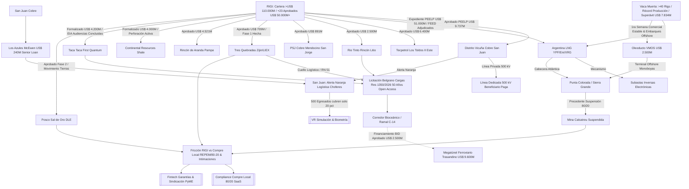

# Oportunidades de Negocio y Conexiones Estratégicas - Octubre 2026

## 1. Oportunidades de Negocio Identificadas (High-Leverage Tech Plays)

1. **Plataformas de Subastas Inversas y Licitación Electrónica para Megaproyectos ([[RIGI]])**:
   - Tras la adjudicación formal de contratos FEED en **Argentina LNG (US$ 51.000M)** y la cartera RIGI superando los **US$ 110.000M**, se consolida la oportunidad para plataformas B2B de compras complejas, calificación técnica automatizada y auditoría criptográfica de ofertas ciegas para proyectos PEELP.

2. **Certificación y Simulación VR para Choferes de Alta Montaña (San Juan / Cobre)**:
   - Tras la declaración de "Alerta Naranja" por la Mesa Logística de San Juan y la constatación de que la cohorte de 500 egresados del Task Force provincial cubre apenas el **20% de la demanda**, la necesidad de simulación inmersiva (VR) y biometría para acelerar la capacitación de 12 meses a 4 semanas es crítica (ver [[VR_Simulacion_Choferes_Alta_Montana_SanJuan]]).

3. **Plataforma RegTech SaaS de Auditoría de Compre y Empleo Local (Regla 80/20 & REPEM)**:
   - Con la escalada de intimaciones administrativas en Catamarca contra Posco y Tres Quebradas y la posibilidad de litigio RIGI vs REPEM (70%-80%), surge una oportunidad prioritaria para una suite RegTech que certifique en tiempo real nóminas de RRHH y facturación de contratistas Tier 2/3 (ver [[Compliance_Compre_Local_8020_SaaS]] y [[Esceptico_Calcatreu_Licencia_Social_REPEM]]).

4. **Software de Despacho y Trazabilidad Intermodal para el Belgrano Cargas (Litio NOA)**:
   - Ante la privatización/concesión inminente del Belgrano Cargas (ofertas 11/11/2026) y el financiamiento del BID para la prefactibilidad del túnel trasandino (US$ 2.500M), se abre un nicho en plataformas de gestión logística intermodal (tren-camión), tracking satelital y optimización de patios de maniobras.

5. **Logística Multimodal y Ruteo de Arenas de Cercanía en Río Negro y Neuquén**:
   - Con más de 40 rigs activos, Continental Resources perforando y 8 millones de toneladas de arena demandadas para 2027, el ruteo de bateas y hubs de transferencia en la "Ruta de las Arenas" de Río Negro resulta prioritario para comprimir costos en boca de pozo.

6. **Microredes Híbridas y Arbitraje BESS para Salares de la Puna**:
   - Con 8 proyectos de litio en producción continua y la resolución de almacenamiento BESS Alma SADI (Res. 155/2026 por 700.5 MW), la integración de bancos de baterías a escala industrial (~US$ 108/kWh) resuelve la saturación del sistema de transmisión andino.

7. **Fintech de Garantías y Sindicación de Capacidad para Proveedores Mineros ([[Fintech_Garantias_y_Sindicacion_Proveedores_Mineros]])**:
   - Motor B2B de scoring crediticio y emisión algorítmica de garantías/cauciones sindicadas para permitir a consorcios PyME locales de San Juan, Catamarca y Salta calificar para licitaciones multimillonarias en [[Distrito Vicuña]] (US$ 18.000M) y [[Los Azules]] (US$ 3.170M).

---

## 2. Conexiones Estratégicas y Grafo de Dependencias

---

## Conexiones
- [[Distrito Vicuña]]
- [[Vaca Muerta]]
- [[RIGI]]
- [[Litio]]
- [[Cobre]]
- [[VMOS]]
- [[San Jorge]]
- [[Tres Quebradas]]
- [[Los Azules]]
- [[Corredor Bioceanico]]
- [[VR_Simulacion_Choferes_Alta_Montana_SanJuan]]
- [[Compliance_Compre_Local_8020_SaaS]]
- [[Fintech_Garantias_y_Sindicacion_Proveedores_Mineros]]
- [[Esceptico_Calcatreu_Licencia_Social_REPEM]]
- [[Esceptico_Megatunel_Bioceanico_Belgrano_Cargas]]